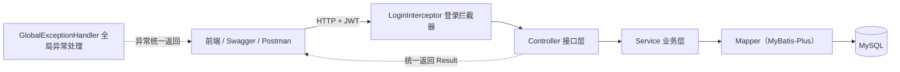
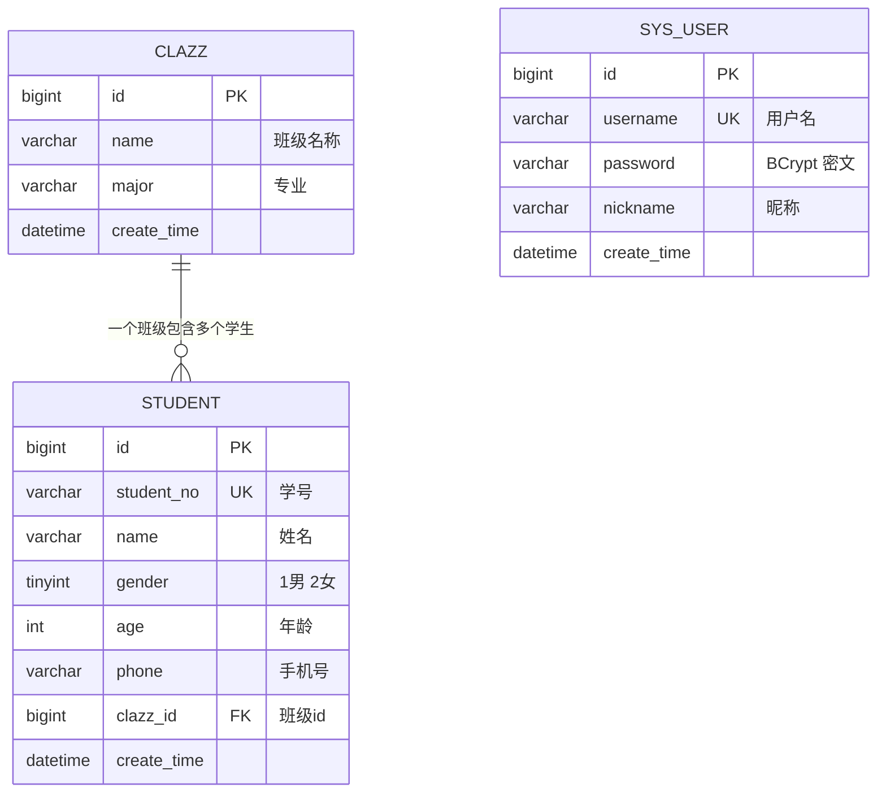

# 学生信息管理系统（student-manage）

> Java 后端 · Spring Boot + MyBatis-Plus + MySQL


## 项目简介

一个前后端分离的后端小项目：提供**登录注册、学生管理、班级管理、数据统计**四类功能，共 13 个 RESTful 接口。项目规模适中（33 个 Java 文件、3 张表），代码分层清晰、命名直观，适合作为 Spring Boot 实战入门项目。

## 项目亮点

1. **登录鉴权链路完整**：注册时密码经 BCrypt 加盐加密入库；登录成功签发 JWT；`LoginInterceptor` 统一拦截 `/api/**`，解析 token 并把用户 id 放入 `request`，未登录/过期统一返回 401。
2. **统一返回 + 全局异常处理**：所有接口返回 `Result<T>`；`@RestControllerAdvice` 集中处理业务异常、参数校验异常、非法 JSON 和兜底异常，前端拿到的格式始终一致。
3. **分页与动态查询**：MyBatis-Plus 分页插件 + `LambdaQueryWrapper` 动态拼接条件，支持姓名/学号模糊搜索、班级筛选。
4. **避免 N+1 查询**：学生列表需要展示班级名称，先收集本页班级 id 一次批量查询再回填，而不是每条学生查一次班级。
5. **自定义统计 SQL**：`LEFT JOIN + GROUP BY` 一条 SQL 返回各班级人数，并统计总人数与男女比例，没有学生的班级也能显示 0。
6. **接口文档**：集成 springdoc-openapi，启动后可直接在 Swagger 页面登录、填 token、调试全部接口。

## 技术栈

| 技术 | 用途 |
| --- | --- |
| Java 17 | 开发语言 |
| Spring Boot 3.5 | Web 框架、依赖注入、自动配置 |
| MyBatis-Plus 3.5 | 单表 CRUD、分页插件、条件构造器 |
| MySQL 8 | 数据存储 |
| JWT (jjwt) | 无状态登录令牌 |
| BCrypt | 密码加密 |
| Bean Validation | 请求参数校验 |
| springdoc-openapi | Swagger 接口文档 |
| Lombok | 简化实体类样板代码 |
| Maven | 构建，已内置 Maven Wrapper |

## 功能模块

| 模块 | 功能 |
| --- | --- |
| 登录注册 | 注册（用户名唯一、BCrypt 加密）、登录签发 token、获取当前用户 |
| 学生管理 | 增删改查、分页、姓名/学号模糊搜索、按班级筛选、学号唯一校验 |
| 班级管理 | 增删改查、列表下拉、班级下有学生时禁止删除 |
| 数据统计 | 学生总数、男生数、女生数、各班级人数分布 |

## 系统架构



分层职责：

- **Controller**：接收参数、参数校验（`@Valid`）、调用 Service、包装 `Result`
- **Service**：业务规则（唯一性校验、班级存在性校验、删除保护）
- **Mapper**：继承 `BaseMapper` 获得单表 CRUD，统计 SQL 使用注解手写
- **Interceptor**：统一登录校验，业务代码不关心 token
- **Exception Handler**：把各类异常转成统一返回结构

## 数据库设计



设计说明：

- `student.student_no` 加唯一索引，代码层先查重给出友好提示，数据库唯一索引兜底并发场景；
- `student.clazz_id` 加普通索引，便于按班级筛选和统计；
- 学生与班级是「多对一」关系，未使用物理外键，由业务层校验班级是否存在。

## 目录结构

```
student-manage
├── sql/init.sql                    建库建表 + 初始化数据（3 个班级、12 名学生）
├── src/main/java/com/example/studentmanage
│   ├── StudentManageApplication.java   启动类
│   ├── common/                     统一返回 Result、分页返回 PageResult、业务异常
│   ├── config/                     MyBatis-Plus 分页、拦截器注册、Swagger、密码加密器
│   ├── controller/                 Auth / Student / Clazz / Stats 四个接口类
│   ├── dto/                        请求参数对象（含校验注解）
│   ├── entity/                     数据库实体 User / Student / Clazz
│   ├── exception/                  全局异常处理
│   ├── interceptor/                LoginInterceptor 登录拦截器
│   ├── mapper/                     MyBatis-Plus Mapper
│   ├── service/                    业务逻辑
│   ├── util/                       JwtUtil
│   └── vo/                         返回给前端的对象 LoginVO / StatsVO / ClazzCount
└── src/main/resources/application.yml
```

## 快速开始

### 1. 初始化数据库

```bash
mysql -uroot -p123456 --default-character-set=utf8mb4 < sql/init.sql
```

脚本会创建 `student_manage` 库、三张表，并插入 3 个班级、12 名学生和 1 个管理员账号。

### 2. 修改数据库配置

编辑 [application.yml](src/main/resources/application.yml) 中的 `username`、`password`。

### 3. 启动项目

- IDEA：打开项目，运行 `StudentManageApplication`
- 命令行（无需安装 Maven，已内置 Wrapper）：

```bash
.\mvnw.cmd spring-boot:run
```

### 4. 打开接口文档

http://localhost:8090/swagger-ui.html

默认账号：`admin / 123456`

> 先调用 `/api/auth/login` 拿到 token，点击右上角 **Authorize** 填入 token，即可调试其它接口。

## 接口清单

| 方法 | 路径 | 说明 | 需要登录 |
| --- | --- | --- | --- |
| POST | /api/auth/register | 注册 | 否 |
| POST | /api/auth/login | 登录，返回 token | 否 |
| GET | /api/auth/me | 当前登录用户信息 | 是 |
| GET | /api/students | 分页查询（pageNum、pageSize、keyword、clazzId） | 是 |
| GET | /api/students/{id} | 学生详情 | 是 |
| POST | /api/students | 新增学生 | 是 |
| PUT | /api/students/{id} | 修改学生 | 是 |
| DELETE | /api/students/{id} | 删除学生 | 是 |
| GET | /api/clazz | 班级列表 | 是 |
| POST | /api/clazz | 新增班级 | 是 |
| PUT | /api/clazz/{id} | 修改班级 | 是 |
| DELETE | /api/clazz/{id} | 删除班级（有学生时失败） | 是 |
| GET | /api/stats | 首页统计数据 | 是 |

统一返回格式：

```json
{
  "code": 200,
  "message": "操作成功",
  "data": {}
}
```

`code`：200 成功，400 业务/参数错误，401 未登录，500 系统异常。

## 示例请求

```bash
# 登录
curl -X POST http://localhost:8090/api/auth/login \
  -H "Content-Type: application/json" \
  -d "{\"username\":\"admin\",\"password\":\"123456\"}"

# 分页查询（关键字"张"，第 1 页，每页 5 条）
curl "http://localhost:8090/api/students?pageNum=1&pageSize=5&keyword=%E5%BC%A0" \
  -H "Authorization: Bearer 你的token"

# 新增学生
curl -X POST http://localhost:8090/api/students \
  -H "Authorization: Bearer 你的token" \
  -H "Content-Type: application/json" \
  -d "{\"studentNo\":\"2024501\",\"name\":\"李雷\",\"gender\":1,\"age\":20,\"phone\":\"13900000001\",\"clazzId\":1}"
```

## 可以继续扩展的方向

- Redis 缓存班级列表与统计数据
- AOP 统一记录操作日志
- Spring Security + 角色权限（管理员/普通用户）
- Excel 导入导出学生名单
- Docker 部署 + Nginx 反向代理

## 注意事项

- `application.yml` 中的数据库账号密码、`jwt.secret` 仅用于本地开发，实际部署请改为环境变量。
- 项目使用 Java 17 编译，本机安装 JDK 17 及以上即可运行；`target/`、`.idea/` 已在 `.gitignore` 中忽略。
